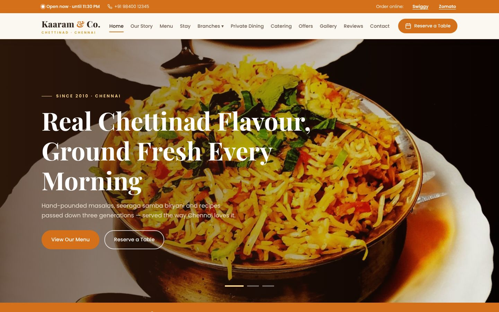
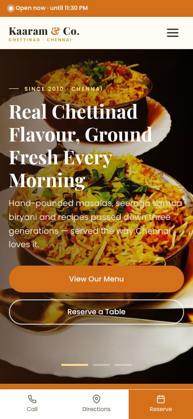
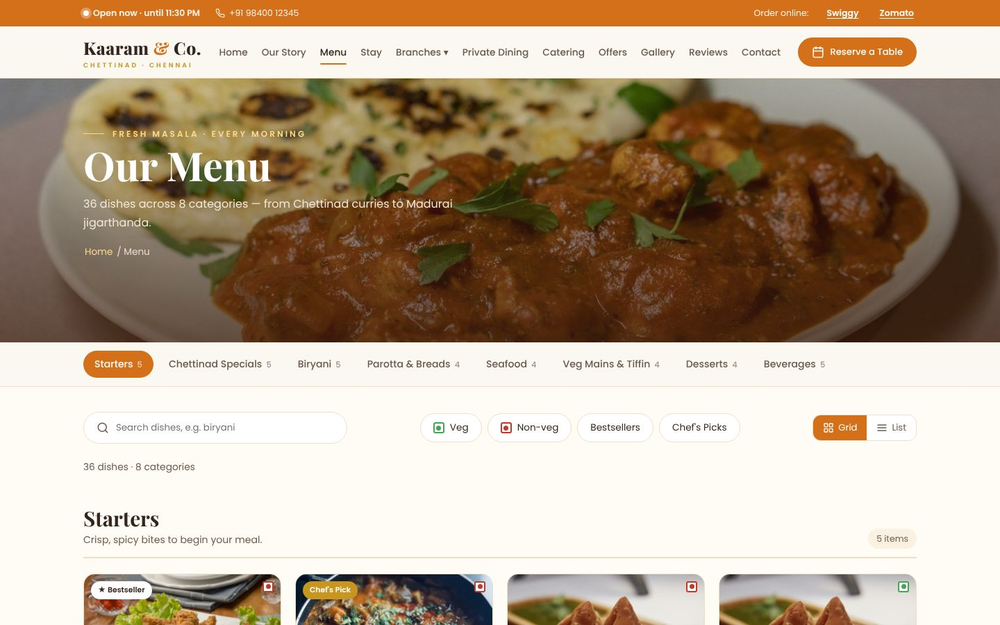
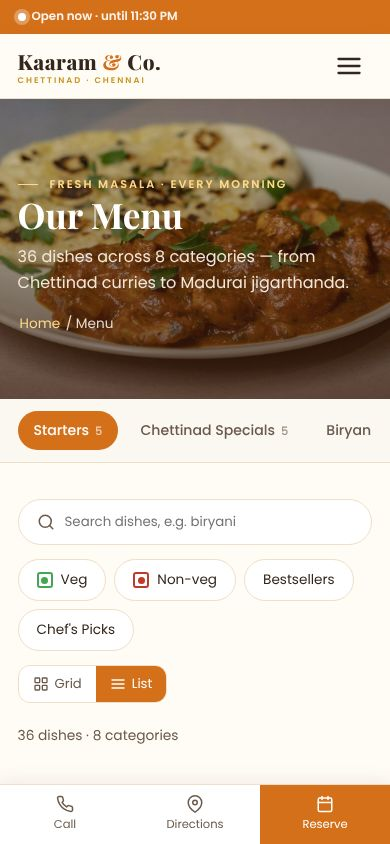
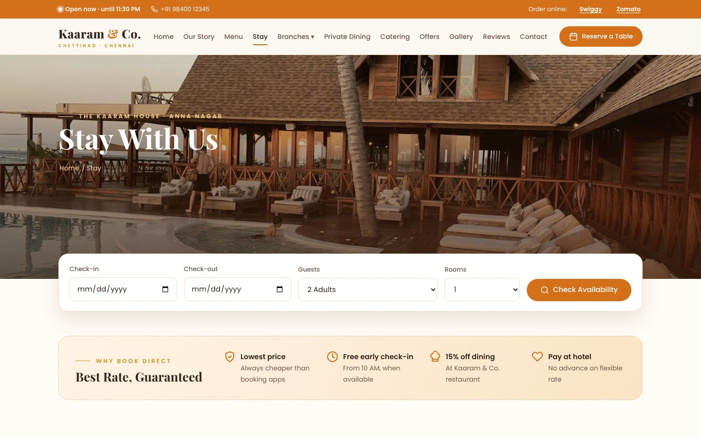
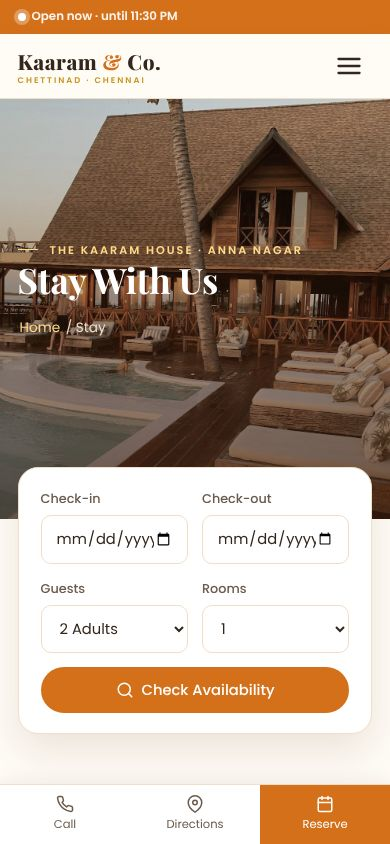
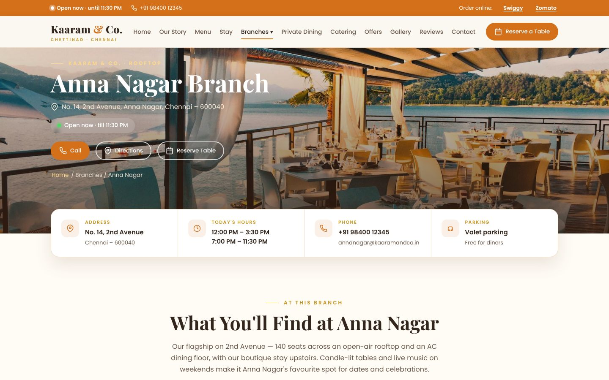

# Kaaram & Co. — Restaurant Website Concept

**A 15-page, multi-branch restaurant website built with plain HTML, CSS and JavaScript — no frameworks, no build step.**

> Portfolio / demonstration project by **Vish Innovations**. Kaaram & Co. is a fictional Chettinad restaurant created to showcase front-end web development work.

---

## Project Preview

| Desktop | Mobile |
| --- | --- |
|  |  |
|  |  |
|  |  |



- **Live website:** _to be added after deployment_
- **GitHub repository:** _to be added_

---

## Project Overview

Kaaram & Co. imagines a Chennai restaurant group serving Chettinad and South Indian food across two branches (Anna Nagar rooftop and Velachery family dining), with a boutique stay above the flagship kitchen, private-dining packages and outdoor catering.

**What the website offers a visitor**

- Browse the full menu, filter it and see prices at a glance
- Check which branch is open right now, and get directions or call in one tap
- Request a table, an event quote, a catering quote or apply for a job
- Explore rooms, offers, the restaurant's story, gallery and customer reviews

**Design and development goals**

- A warm, food-first visual identity that feels like a real restaurant brand
- A mobile-first experience, since most restaurant visitors browse on phones
- A clean, maintainable codebase that a developer can edit without tooling: content lives in data files, shared page chrome is written once

---

## Key Features

- **15-page website** with consistent header, footer and navigation
- **Menu explorer:** 36 dishes across 8 categories with search, veg / non-veg / bestseller / chef's-pick filters and grid or list view
- **Live open/closed status** for the top bar and each branch, calculated from per-day opening schedules (including late-night weekend hours that run past midnight)
- **Table reservation modal** that can be opened from any page, with validation and a pre-filled WhatsApp confirmation link
- **Stay section:** 5 room and suite types, room detail modals, rate-plan toggle (flexible vs non-refundable) and an availability check form
- **Offers, weekly specials (one per weekday), signature dishes and customer reviews** rendered from data files
- **Event and catering pages** with party packages, décor gallery and a "how it works" scroll-driven stepper
- **Filterable photo gallery** with a full-screen lightbox
- **Story page** with a scroll-driven timeline
- **Careers page** with job listings that pre-select the role in the application form
- **Two branch pages from one template**, each with hours, facilities, directions and branch-specific reviews
- **Contact page** with embedded maps and an FAQ accordion
- **Forms with client-side validation** (required fields, Indian mobile number format, future-date checks) and animated confirmation panels
- **Hero slider and review carousel**, scroll-reveal animations and count-up statistics
- **Branded image fallback:** any image that fails to load shows a "Kaaram & Co." placeholder instead of a broken icon
- **Basic SEO:** per-page titles and descriptions, and Restaurant structured data (JSON-LD) on the home page

> Forms are a front-end demonstration. They validate input and show a confirmation, but nothing is sent to a server.

---

## Pages & Modules

| Page | File | Purpose |
| --- | --- | --- |
| Home | `index.html` | Hero slider, signature dishes, branches, weekly specials, offers, stay teaser, reviews |
| Our Story | `story.html` | Restaurant background and animated timeline |
| Menu | `menu.html` | Searchable, filterable menu |
| Stay | `stay.html` | Rooms, rate plans, availability check, room details |
| Private Dining | `events.html` | Party packages, décor gallery, event enquiry form |
| Catering | `catering.html` | Catering services, process stepper, quote form |
| Offers | `offers.html` | Current promotions |
| Gallery | `gallery.html` | Filterable gallery with lightbox |
| Reviews | `reviews.html` | Customer feedback |
| Careers | `careers.html` | Open roles and application form |
| Contact | `contact.html` | Branch contacts, maps, FAQ, enquiry form |
| Anna Nagar | `annanagar.html` | Branch information (rooftop flagship) |
| Velachery | `velachery.html` | Branch information (family dining) |
| Privacy | `privacy.html` | Privacy policy |
| Terms | `terms.html` | Terms and conditions |

---

## Technologies Used

| Technology | How it is used |
| --- | --- |
| **HTML5** | One real HTML file per page, semantic structure, per-page metadata |
| **CSS3** | Custom properties, `clamp()` fluid spacing, CSS Grid and Flexbox, modular stylesheets |
| **Vanilla JavaScript (ES6+)** | Shared components, page scripts, data rendering, forms, sliders, lightbox |
| **SVG** | Favicon and an inline icon set (`js/core/icon-paths.js`) |
| **JSON-LD** | Restaurant structured data on the home page for search engines |
| **Google Fonts** | Playfair Display and Poppins (loaded from the web) |
| **Google Maps embeds** | Branch maps on the contact page |

---

## UI/UX & Responsive Design

- **Mobile-first, fluid layout:** side padding and section spacing scale with `clamp()`; the content container is capped at 75rem
- **Multiple breakpoints** from small phones (380px) through tablets to large screens (1600px and 2200px, where the base font size scales up)
- **Navigation:** full desktop menu with a Branches dropdown; below 1180px it becomes a slide-in drawer with a scrim
- **Mobile action bar:** fixed Call / Directions / Reserve buttons on small screens
- **Typography:** Playfair Display headings with Poppins body text, and a warm saffron, gold and cream colour palette defined once as CSS variables
- **Interactive elements:** modals, lightbox, accordions, carousels, filters, toasts and scroll animations
- **Accessibility measures implemented:** descriptive `alt` text on content images, `aria-label` on icon-only buttons, `aria-expanded` on the menu toggle, and `Esc` to close the menu, modals and lightbox. A full accessibility audit has not been carried out.

---

## Project Architecture

The site is **page-based with shared, script-rendered chrome and data-driven content**.

1. **HTML:** each page contains only its own content. `<body data-page="menu">` identifies the page, and a single script, `js/boot.js`, is included.
2. **Loader (`js/boot.js`):** loads the shared scripts, then the scripts and data files that page needs, then `main.js`, in order. Plain `<script>` tags are used (not ES modules) so the site also works when opened directly from the file system.
3. **Shared namespace:** every script is an IIFE that attaches its functions to one global `App` object.
4. **Entry point (`js/main.js`):** injects the shared header, footer and modals, starts the shared components (navigation, forms, lightbox, reservation modal, open-status ticker), then mounts the page's own script.
5. **Shared components:** `js/components/layout.js` holds the header, nav and footer once, so a navigation change is a one-file edit for all 15 pages.
6. **Page scripts:** `js/pages/*.js` each expose a `mount()` that renders that page's dynamic sections. The two branch pages share one template (`branch.js`) driven by `data-branch`.
7. **Data separation:** menu, rooms, offers, reviews, branches, jobs, FAQ, packages and more live in `js/data/*.js`, apart from the UI code.
8. **CSS organisation:** `css/main.css` imports everything in cascade order: `base.css` (variables, reset, typography), `layout/`, `components/` and `pages/`.
9. **Asset management:** images are referenced by key, e.g. `` resolves to `assets/images/food/biryani-plate.jpg`, so paths are defined in one place.

---

## Folder Structure

```
kaaram-v2/
├── index.html  menu.html  stay.html  story.html  events.html  catering.html
├── offers.html  gallery.html  reviews.html  careers.html  contact.html
├── annanagar.html  velachery.html  privacy.html  terms.html
├── css/
│   ├── main.css            Entry point — imports all stylesheets in order
│   ├── base.css            Variables, reset, typography, buttons, utilities
│   ├── layout/             header, grid, footer
│   ├── components/         banner, card, controls, form, modal, lightbox, faq, toast, ...
│   └── pages/              One stylesheet per page or page group
├── js/
│   ├── boot.js             Loads the right scripts for the current page
│   ├── main.js             Entry point: injects layout, starts components, mounts page
│   ├── core/               dom, format, icons, images, observers, hydrate
│   ├── components/         layout, nav, forms, lightbox, sliders, toast, reserve-modal, open-status, ...
│   ├── pages/              One script per page (12 files)
│   └── data/               Content as data (14 files): menu, rooms, offers, reviews, branches, ...
├── assets/
│   ├── favicon.svg
│   └── images/             60 photos: food/ venues/ stay/ events/ people/ kitchen/ catering/
└── docs/
    └── screenshots/        README preview images
```

---

## Getting Started

**Prerequisites:** a modern web browser. No Node.js, package manager or build step is needed.

```bash
git clone <repository-url>
cd kaaram-v2
```

**Run it:** double-click `index.html`, or open it from your browser's *File → Open* menu. A local server is **not required**; all 15 pages were opened directly from the file system and loaded without JavaScript errors.

If you prefer a local server:

```bash
python -m http.server 8000
# then open http://localhost:8000
```

An internet connection is needed for the web fonts and the Google Maps embeds. Without it, the site still works with fallback fonts and empty map frames.

---

## Customization Guide

| To change… | Edit |
| --- | --- |
| Menu items, prices, spice level, tags | `js/data/menu.js` |
| Restaurant and branch details (address, phone, hours, facilities) | `js/data/branches.js` |
| Rooms and rates | `js/data/rooms.js` |
| Offers, weekly specials, signature dishes | `js/data/offers.js`, `weekly-specials.js`, `signature-dishes.js` |
| Reviews, FAQ, jobs, party packages, story timeline | `js/data/reviews.js`, `faq.js`, `jobs.js`, `packages.js`, `journey.js` |
| Navigation links, footer, top bar, reservation modal | `js/components/layout.js` (changes every page) |
| Colours, fonts, spacing | CSS variables at the top of `css/base.css` |
| Page-specific styling | `css/pages/<page>.css` |
| Static page content | the matching `.html` file |
| Images | add a `.jpg` to `assets/images/<folder>/` and reference it as `<folder>/<name>` |

**Adding a page:** copy an existing `.html` file, change `data-page` and the content; if it needs JavaScript, create `js/pages/<name>.js`, list it in `PAGE_SCRIPTS` in `js/boot.js`, and add the link in `layout.js`.

---

## Responsive Testing & Browser Compatibility

Automated checks were run on all 15 pages by opening them from the file system in headless **Google Chrome (Chromium)**.

| Viewport | Result |
| --- | --- |
| Mobile, 390 px | All pages loaded without JavaScript errors; no horizontal overflow |
| Tablet, 768 px | All pages loaded without JavaScript errors; no horizontal overflow |
| Desktop, 1366 px | All pages loaded without JavaScript errors; no horizontal overflow |

- The story-page timeline was additionally checked at 320, 390, 768, 900, 1024, 1180, 1280 and 1920 px with no horizontal overflow.
- **Not yet tested:** Firefox, Safari, Edge, physical devices, and screen sizes beyond those above. Browser compatibility is therefore not claimed.

---

## Credits & Image Sources

- **Photography:** [Unsplash](https://unsplash.com). Photos are used under the [Unsplash License](https://unsplash.com/license).
- **Fonts:** [Playfair Display](https://fonts.google.com/specimen/Playfair+Display) and [Poppins](https://fonts.google.com/specimen/Poppins) via Google Fonts (SIL Open Font License).
- **Maps:** Google Maps embeds on the contact page.
- **Icons:** custom inline SVG icon set included in the project; no third-party icon library.
- **Frameworks and libraries:** none.

---

## Project Disclaimer & Credits

- Kaaram & Co. is a **fictional restaurant** created as a conceptual demonstration website.
- Restaurant branding, menu, prices, addresses, phone numbers, reviews and offers are sample content for portfolio purposes only.
- This is not an operational restaurant or a real booking, ordering or payment platform. Forms do not send data anywhere.
- Photographs belong to their respective photographers (see Credits above).

**Designed and developed by Vish Innovations** as a front-end portfolio project.
